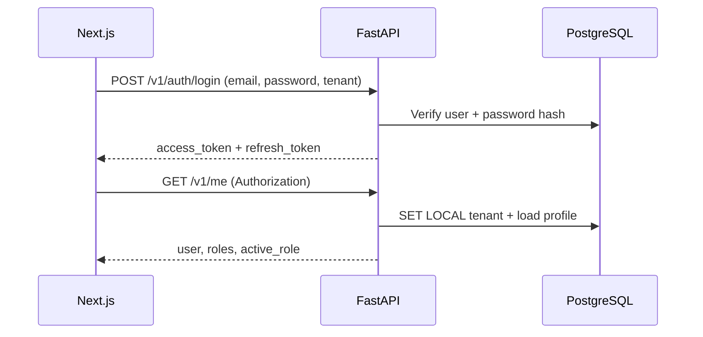

# CampusOS — System Architecture & Security Model

**Version:** 1.1  
**Status:** MVP baseline  
**Related:** [`DATABASE_SCHEMA.md`](./DATABASE_SCHEMA.md), [`API_SPECIFICATION.md`](./API_SPECIFICATION.md), [`CampusOS_MVP_Scope.md`](./CampusOS_MVP_Scope.md)

---

## 1. High-Level System Topology

CampusOS follows a **modular monolith** backend paired with a **role-adaptive web frontend**, optimized for strict multi-tenant isolation and p95 API latency under 200 ms for core reads/writes.

```text
+-------------------------------------------------------------------------+
|                        CLIENT LAYER (Web / Mobile)                      |
|  [Principal UI]  [Faculty UI]  [Student UI]  [Parent UI]  [Finance UI]  |
+------------------------------------+------------------------------------+
                                     | HTTPS / TLS 1.3
                                     | JWT + optional X-Tenant-ID (super admin)
                                     v
+-------------------------------------------------------------------------+
|                         API GATEWAY & MIDDLEWARE                        |
|  1. Tenant resolver (subdomain / JWT claim -> SET LOCAL tenant)        |
|  2. RBAC guard (active_role + resource scope)                           |
|  3. Request ID + structured logging                                    |
|  4. Idempotency interceptor (Redis) for billing & webhooks             |
|  5. Rate limiting (Redis) per tenant + per user                         |
+------------------------------------+------------------------------------+
                                     |
        +----------------------------+----------------------------+
        v                            v                            v
+----------------+        +--------------------+        +------------------+
| Academic &     |        | Timetable &        |        | Finance &        |
| Directory      |        | Attendance         |        | Gradebook        |
| (FastAPI       |        | Engine             |        | (FastAPI         |
|  routers)      |        |                    |        |  routers)        |
+--------+-------+        +---------+----------+        +--------+---------+
         |                          |                            |
         +--------------------------+----------------------------+
                                     | SQLAlchemy 2.0 async session
                                     | BEGIN; SET LOCAL app.current_tenant_id
                                     v
+-------------------------------------------------------------------------+
|                    POSTGRESQL 16 (shared schema + RLS)                  |
+------------------------------------+------------------------------------+
                                     | transactional outbox / NOTIFY
                                     v
+-------------------------------------------------------------------------+
|              REDIS + ASYNC WORKERS (Celery / ARQ / RQ)                  |
|  - Parent absence notifications (email + in-app, < 5 min SLA)          |
|  - Batch PDF invoices & receipts                                       |
|  - CSV import validation jobs                                           |
+-------------------------------------------------------------------------+
                                     |
                                     v
+-------------------------------------------------------------------------+
|              OBJECT STORAGE (S3 / MinIO) — receipts, uploads           |
+-------------------------------------------------------------------------+
```

---

## 2. Architectural Goals & Constraints

| Goal | Approach |
| :--- | :--- |
| Tenant isolation | Shared schema + mandatory `tenant_id` + PostgreSQL RLS + API guards |
| Predictable MVP delivery | Modular monolith (not microservices) with clear router boundaries |
| Auditability | Append-only `audit_logs` for sensitive mutations |
| Safe money paths | Idempotency keys + ledger-style fee tables (MVP: simplified balances; Phase 2: full double-entry) |
| Operability | Health checks, OpenAPI, structured JSON logs, request correlation IDs |

**Out of scope for MVP architecture:** multi-region active-active, event sourcing, separate read replicas, SAML SSO.

---

## 3. Multi-Tenancy Model

### 3.1 Tenant resolution order

1. **JWT claim** `tenant_id` (normal institution users).
2. **Host/subdomain** `{subdomain}.campusos.io` mapped to `tenants.subdomain` when JWT is absent (login page only).
3. **Super Admin** may pass `X-Tenant-Id` when operating cross-tenant provisioning APIs.

Every authenticated request must resolve to exactly one `tenant_id` before hitting domain services.

### 3.2 Database session pattern

On each request, after JWT validation:

```sql
BEGIN;
SET LOCAL app.current_tenant_id = '<uuid>';
-- all queries run under RLS policies comparing tenant_id
COMMIT;
```

SQLAlchemy event hook or FastAPI dependency sets `SET LOCAL` on connection checkout.

### 3.3 Cross-tenant access

| Scenario | Expected behavior |
| :--- | :--- |
| User A queries resource UUID from Tenant B | `404 Not Found` (preferred) or `403 Forbidden` |
| Super Admin lists tenants | Dedicated `/v1/platform/tenants` routes without RLS bypass in app code |
| Background job | Job payload includes `tenant_id`; worker sets `SET LOCAL` before work |

---

## 4. Security Architecture

### 4.1 Authentication

* **Access token:** JWT RS256, short TTL (e.g., 15 minutes).
* **Refresh token:** HTTP-only cookie or rotating refresh table (hashed), bound to `tenant_id`.
* **Claims:** `sub`, `tenant_id`, `roles[]`, `active_role`, `session_id`.

Login flow:



### 4.2 Authorization (RBAC)

Permissions are evaluated as:

`allowed = role_permission[active_role][resource][action] AND resource.tenant_id == jwt.tenant_id AND scope_rule(user, resource)`

Scope examples:

* **Faculty:** attendance write only for assigned `timetable_slots`.
* **Parent:** read only linked students via `parent_student_links`.
* **Student:** read self only.

Composite role switching issues a new access token with updated `active_role` (and optional `linked_student_id` for parents).

### 4.3 Threat mitigations (MVP)

| Threat | Mitigation |
| :--- | :--- |
| IDOR across tenants | RLS + never trust client-supplied `tenant_id` without Super Admin path |
| Replay on payments | `Idempotency-Key` + unique `gateway_transaction_id` |
| Privilege escalation | Server-side RBAC only; frontend guards are UX-only |
| SQL injection | SQLAlchemy parameterized queries; migrations reviewed |
| XSS | React default escaping; CSP headers on web app |

---

## 5. Backend Module Boundaries (Modular Monolith)

Suggested FastAPI package layout:

```text
apps/api/app/
├── main.py
├── core/           # config, security, logging
├── middleware/     # tenant, rbac, idempotency
├── modules/
│   ├── auth/
│   ├── tenants/
│   ├── academics/
│   ├── timetable/
│   ├── attendance/
│   ├── finance/
│   ├── gradebook/
│   ├── announcements/
│   └── audit/
├── workers/        # notification, pdf, csv_import
└── db/             # session, base models, rls helpers
```

**Integration rule:** modules communicate via service functions or shared DB within one transaction—not HTTP between internal modules.

---

## 6. Core Workflows

### 6.1 Timetable conflict validation

On `POST /v1/timetable/slots` or bulk publish:

1. Load candidate slot (`room_id`, `faculty_user_id`, `section_id`, `day_of_week`, `starts_at`, `ends_at`).
2. Check **room overlap** with existing published slots in tenant.
3. Check **faculty overlap** across sections.
4. Check **room capacity** ≥ enrolled section headcount.
5. On conflict → HTTP `409` with `TIMETABLE_CONFLICT` (see API spec).

All checks run in a single DB transaction with advisory lock optional per `(tenant_id, room_id, day, starts_at)` for race safety.

### 6.2 Attendance submission → parent alert

1. Faculty submits session records (default `PRESENT`).
2. Persist `attendance_sessions` + `attendance_records`.
3. Insert outbox rows for each `ABSENT` unexcused record.
4. Worker sends email + in-app notification within 5 minutes.
5. Recompute rolling attendance %; set shortage flags at **80%** (warning) and **75%** (risk).

### 6.3 Batch invoicing

1. Finance Admin triggers batch with `Idempotency-Key`.
2. Worker creates invoices per enrolled student in scope.
3. Duplicate key returns `200` with original batch summary (no double billing).

---

## 7. Frontend Architecture (summary)

* **Next.js App Router** with route groups per role: `(principal)`, `(faculty)`, `(student)`, `(parent)`, `(finance)`, `(platform)`.
* **Server Components** for read-heavy dashboards; **Client Components** for interactive grids (attendance, timetable builder).
* **API client** generated from OpenAPI or thin `fetch` wrapper with token refresh.
* **State:** React Query (TanStack Query) for server cache; URL state for filters.

Full route and component conventions: [`UI.md`](./UI.md).

---

## 8. Observability & Operations

| Concern | MVP approach |
| :--- | :--- |
| Logging | JSON logs with `request_id`, `tenant_id`, `user_id`, `active_role` |
| Metrics | Prometheus-compatible `/metrics` (optional in dev) |
| Tracing | OpenTelemetry hooks in FastAPI middleware (Phase 1.5) |
| Health | `GET /health` (liveness), `GET /ready` (DB + Redis) |
| Backups | Daily PG snapshots; RPO < 15 min per BRD NFRs |

---

## 9. Deployment Topology (reference)

```text
                    [CDN / Vercel — Next.js]
                              |
                    [Load balancer / API gateway]
                              |
              +---------------+---------------+
              v               v               v
        [API replicas]   [Worker replicas]  [Redis]
              |                               |
              +---------------+---------------+
                              v
                      [PostgreSQL 16]
                              |
                      [S3-compatible storage]
```

Local development uses Supabase for PostgreSQL and optional Docker Compose for Redis (see [`README.md`](./README.md) and [`SUPABASE.md`](./SUPABASE.md)).

---

## 10. Evolution Path (post-MVP)

| Phase | Architectural change |
| :--- | :--- |
| Phase 2 | Payment gateway webhooks, full double-entry ledger service, grade publication workflow |
| Phase 3 | Exam seating solver as isolated worker; hardware webhook ingestion; read replica for analytics |

Major upgrades (e.g., splitting attendance high-write path) require an ADR recorded in `docs/adr/` (folder to be added when first ADR is written).